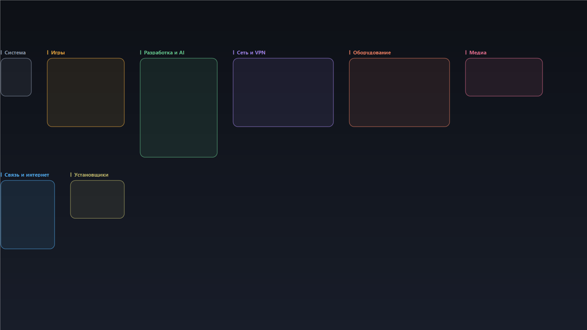

# DesktopGroups

Group desktop shortcuts into rectangles — and let the wallpaper draw the frames
and labels for those groups.

**Русская версия: [README.ru.md](README.ru.md)**



## Why another desktop organizer

Existing tools (Stardock Fences, DexCorral, Gridify, DeskRipple) draw their groups
as an **overlay window** on top of the desktop. That means a resident process,
hooks into Explorer, and a group that disappears when the tool is not running.

DesktopGroups does the opposite: it **bakes the group frames into the wallpaper**.
There is no background process and no overlay window; the desktop stays a normal
desktop, and the groups survive reboots because they are just icons on a grid.
Icon positions are set through the desktop list view's own `LVM_*` messages —
no code is injected into Explorer, only the item-position structures it already
understands (details in [SECURITY.md](SECURITY.md)).

The trade-off is honest: frames are static. Move an icon by hand and the frame
will no longer match — re-apply the layout and both are rebuilt from one plan.

## Features

- Scans shortcuts, folders and files on the desktop (current user + `Public`).
- Proposes groups by name heuristics (games, dev/AI, chat, media, VPN/remote,
  hardware, installers, system, everything else).
- Create, rename, delete and reorder your own groups; move icons between groups.
- Lays icons out as exact rectangles (a block has no empty cells when possible).
- Generates a wallpaper at your screen size with rounded frames, per-group colors
  and labels.
- **Your own background image** under the frames: pick any picture, it is scaled
  to fill the screen, dimmed for readability, and the frames are drawn on top.
- **Two interface languages, Russian and English**, switched in the window and
  remembered in the config.
- Keeps `config.json` next to the app and a backup of previous icon positions
  before every apply; one click restores the previous layout.
- Verifies the result: reads the positions back and reports any icon that did not land.

## Requirements

- Windows 10 or 11.
- Windows PowerShell 5.1 (built in). PowerShell 7 works for the engine, the GUI is
  started through `powershell.exe`.
- No administrator rights, no external packages, no network.

## Install

Nothing to compile: the program is plain PowerShell plus one C# helper that is
compiled in memory at startup by `Add-Type`.

1. Download `DesktopGroups-<version>.zip` from the [Releases](../../releases) page
   and unpack it anywhere.
2. If Windows marked the files as downloaded, right-click the ZIP →
   **Properties** → **Unblock**, or run
   `Get-ChildItem -Recurse | Unblock-File` in the unpacked folder.
3. Run **`install.cmd`**. It copies the program to
   `%LOCALAPPDATA%\Programs\DesktopGroups`, creates a Start Menu shortcut and an
   entry in *Apps & features*. No administrator rights are needed.
4. Start it from the Start Menu.

Prefer a portable setup? Skip `install.cmd` and run `DesktopGroups.cmd` from the
unpacked folder — nothing is written outside that folder except your own
`config.json` and `wallpaper.png`.

To remove it, use *Apps & features* in Windows settings, or run `uninstall.cmd`.
Your previous wallpaper is restored, and your groups are copied to
`%APPDATA%\DesktopGroups` before the program folder is deleted. A portable copy
needs `uninstall.cmd -Force`, because the whole unpacked folder is removed.

### Verify what you downloaded

Each release ships `SHA256SUMS.txt` and a signed build-provenance attestation:

```powershell
Get-FileHash .\DesktopGroups-1.1.0.zip -Algorithm SHA256   # compare with SHA256SUMS.txt
gh attestation verify .\DesktopGroups-1.1.0.zip --repo mikel38487/DesktopGroups
```

Why Windows may still warn on first run, and which options exist to remove that,
is written down honestly in [SECURITY.md](SECURITY.md#smartscreen-code-signing-and-why-you-see-a-warning).
Repository guards (Dependabot, secret scanning, Scorecard, pinned actions) are
listed in [docs/github-security.md](docs/github-security.md).

## Quick start

1. **Scan desktop** — read what is on the desktop right now.
2. **Suggest groups** — fill groups from icon names, then adjust by hand.
3. **New / Rename / Delete / ↑ ↓** — build your own set.
4. **Background image…** — optional picture under the frames.
5. **Lay out icons and update wallpaper** — place the icons and draw the wallpaper.

Detailed instructions, including edge cases and troubleshooting:
**[docs/guide.md](docs/guide.md)** (English) · **[docs/guide.ru.md](docs/guide.ru.md)** (Russian).

## Interface language

The window has a language selector in the top right corner: **Русский** / **English**.
The choice is stored in `config.json` as `"language": "ru"` or `"en"` and survives restarts.

On first run the language follows the language of Windows (`InstalledUICulture`).
You can also force it for one run:

```powershell
powershell.exe -STA -ExecutionPolicy Bypass -File .\DesktopGroups.ps1 -Lang en
```

Note: group names are your data, not interface text. Switching the language
translates the window, the suggested group names (on the next **Suggest groups**)
and the special "Misc" group — it does not rename groups you created yourself.

## Background image

Click **Background image…**, pick a PNG, JPEG, BMP or GIF file.

- The picture is scaled to fill the screen (center crop, no distortion).
- Phone photos are rotated by their EXIF orientation, so they do not land sideways.
- A dark gradient veil is applied so labels stay readable on bright photos.
- Group frames and labels are drawn on top, each label on its own dark plate.
- The path is stored in `config.json` as `"background": "C:\\pics\\wall.png"`.
- **No background** returns to the default dark gradient.
- The file is read into memory and never locked, so you can move or delete it later
  without breaking the program; a missing file simply falls back to the gradient.

Files above 100 MB, or images above 100 megapixels, are rejected. Broken images are
reported and never stored. Transparent areas show the dark gradient underneath.

## Troubleshooting

**Windows says "running scripts is disabled on this system".**
Launch through `DesktopGroups.cmd` or `install.cmd`: they pass
`-ExecutionPolicy Bypass` for that one process. The system-wide policy is not
changed. If the policy is enforced by group policy (`MachinePolicy`), `Bypass`
will not help — that is a machine restriction.

**SmartScreen or "Windows protected your PC".**
The files are not code-signed. Right-click the ZIP → **Properties** →
**Unblock** before unpacking, or run `Get-ChildItem -Recurse | Unblock-File`
in the unpacked folder.

**Antivirus flags the program.**
`lib\DesktopIcons.cs` is compiled in memory at startup and calls
`WriteProcessMemory` into `explorer.exe` — this is how icon positions are set
without an Explorer restart. Some heuristics dislike that combination. The whole
source is here; you can read exactly what is written (an `LVITEM`/`POINT`
structure, nothing else) and check it with PSScriptAnalyzer.

**Frames do not line up with the icons.**
The wallpaper is generated at the size of your current screen. If you changed
resolution or DPI after applying, press **Lay out icons and update wallpaper**
again.

**Icons moved by themselves.**
"Auto arrange icons" is on. Turn it off: right-click the desktop →
**View** → uncheck **Auto arrange icons**.

## Limitations

- **Primary monitor only.** Icons and frames are laid out for the primary display.
- **Static frames.** Move an icon by hand and it leaves its cell; re-apply to rebuild.
- **No drag & drop on the desktop.** Groups are edited in the window.
- **Auto arrange must stay off**, otherwise Windows re-sorts the icons.
- **No code signature**, so SmartScreen may warn on the first run — see
  [SECURITY.md](SECURITY.md#smartscreen-code-signing-and-why-you-see-a-warning).
- **At most 100 megapixels per background image** to keep memory sane.

## Development

Checks that never touch the desktop (these run in CI):

```powershell
powershell.exe -NoProfile -File .\tests\check-encoding.ps1   # BOM + parser under 5.1 and 7
powershell.exe -NoProfile -File .\tests\smoke.ps1            # grouping, layout, wallpaper
powershell.exe -NoProfile -File .\tests\i18n.ps1             # translation completeness
powershell.exe -NoProfile -File .\tests\fuzz-config.ps1      # junk values in config.json
Invoke-ScriptAnalyzer -Path . -Recurse -Settings .\PSScriptAnalyzerSettings.psd1
```

Manual tests really move icons and change the wallpaper, so they stay off
unless you opt in:

```powershell
$env:DESKTOPGROUPS_MANUAL_TESTS = 1
powershell.exe -File .\tests\manual\apply-all.ps1
```

Build the release archive locally:

```powershell
powershell.exe -NoProfile -File .\tools\build-package.ps1
```

## Project layout

| Path | Purpose |
|---|---|
| `DesktopGroups.ps1` | GUI (WinForms), bilingual |
| `lib\Engine.ps1` | scanning, grouping, layout, wallpaper, apply |
| `lib\Strings.ps1` | interface strings for Russian and English |
| `lib\DesktopIcons.cs` | P/Invoke and desktop list-view lookup |
| `tools\install.ps1`, `tools\uninstall.ps1` | install and remove without admin rights |
| `tests\` | automatic checks; `tests\manual\` is opt-in |
| `docs\` | user guide, security notes, review reports |

## License

MIT — see [LICENSE](LICENSE).
