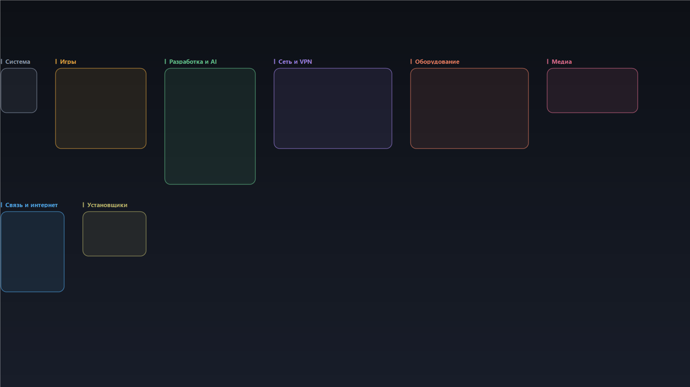

# DesktopGroups

Раскладывает ярлыки рабочего стола по прямоугольным группам, а **обои рисуют
рамки и подписи** этих групп.

**English version: [README.md](README.md)**



## Зачем ещё одна программа

Готовые решения (Stardock Fences, DexCorral, Gridify, DeskRipple) рисуют группы
**поверх** рабочего стола отдельным окном: нужен резидентный процесс, перехват
Explorer, и без запущенной программы групп нет.

DesktopGroups делает наоборот: рамки групп **впечатаны в обои**. Нет фонового
процесса и оверлей-окна, рабочий стол остаётся обычным, а группы переживают
перезагрузку — это просто значки на сетке. Позиции значков задаются сообщениями
`LVM_*` самому списку значков: код в Explorer не внедряется, передаются только
структуры позиций, которые он и так понимает (подробности в
[SECURITY.ru.md](SECURITY.ru.md)).

Плата честная: рамки статичны. Подвинули ярлык руками — рамка перестанет
совпадать; повторное применение раскладки перестроит и то и другое из одного плана.

## Возможности

- Сканирует ярлыки, папки и файлы рабочего стола (свой и общий `Public`).
- Предлагает группы по именам: игры, разработка/AI, связь, медиа, VPN и
  удалённый доступ, оборудование, установщики, система, остальное.
- Свои группы: создать, переименовать, удалить, менять порядок; переносить
  значки между группами.
- Раскладывает значки точными прямоугольниками — без пустых ячеек, где возможно.
- Рисует обои в размере экрана: скруглённые рамки, цвет группы, подпись над рамкой.
- **Свой фоновый рисунок** под рамками: любая картинка растягивается на экран,
  затемняется для читаемости, рамки и подписи рисуются поверх.
- **Два языка интерфейса, русский и английский**: переключаются в окне и
  запоминаются в конфиге.
- Хранит `config.json` рядом с программой и бэкап прежних позиций перед каждым
  применением; прошлую раскладку можно вернуть одной кнопкой.
- Проверяет результат: перечитывает позиции и сообщает, какие значки не встали.

## Требования

- Windows 10 или 11.
- Windows PowerShell 5.1 (встроен). Движок работает и в PowerShell 7, GUI
  запускается через `powershell.exe`.
- Без прав администратора, без внешних пакетов и сети.

## Установка

Компилировать ничего не нужно: программа — это PowerShell плюс один C#-файл,
который собирается в памяти при старте через `Add-Type`.

1. Скачайте `DesktopGroups-<версия>.zip` со страницы [Releases](../../releases)
   и распакуйте в любую папку.
2. Если Windows пометила файлы как скачанные — правый клик по ZIP →
   **Свойства** → **Разблокировать**, либо в распакованной папке выполните
   `Get-ChildItem -Recurse | Unblock-File`.
3. Запустите **`install.cmd`**. Он скопирует программу в
   `%LOCALAPPDATA%\Programs\DesktopGroups`, сделает ярлык в меню «Пуск» и запись
   в списке приложений. Права администратора не нужны.
4. Запускайте из меню «Пуск».

Нужен портативный вариант? Не запускайте `install.cmd`, а запустите
`DesktopGroups.cmd` прямо из распакованной папки — вне неё появятся только
ваши `config.json` и `wallpaper.png`.

Удаление — через «Приложения» в параметрах Windows или `uninstall.cmd`.
Прежние обои при удалении восстанавливаются.

## Быстрый старт

1. **Сканировать стол** — прочитать, что лежит на столе сейчас.
2. **Предложить группы** — заполнить группы по именам, дальше править руками.
3. **Новая / Переименовать / Удалить / ↑ ↓** — собрать свой набор.
4. **Фоновый рисунок…** — при желании картинка под рамками.
5. **Разложить значки и обновить обои** — расставить значки и нарисовать обои.

Подробная инструкция, крайние случаи и разбор проблем:
**[docs/guide.ru.md](docs/guide.ru.md)** (русский) · **[docs/guide.md](docs/guide.md)** (английский).

## Язык интерфейса

В правом верхнем углу окна переключатель: **Русский** / **English**.
Выбор хранится в `config.json` как `"language": "ru"` или `"en"` и переживает
перезапуск.

При первом запуске язык берётся из языка Windows (`InstalledUICulture`).
Можно задать принудительно на один запуск:

```powershell
powershell.exe -STA -ExecutionPolicy Bypass -File .\DesktopGroups.ps1 -Lang ru
```

Важно: названия групп — это ваши данные, а не текст интерфейса. Смена языка
переводит окно, предлагаемые названия групп (при следующем «Предложить группы»)
и служебную группу «Прочее»/«Misc», но не переименовывает созданные вами группы.

## Фоновый рисунок

Нажмите **Фоновый рисунок…** и выберите PNG, JPEG, BMP, GIF или WEBP.

- Картинка растягивается на весь экран с сохранением пропорций (обрезка по центру).
- Сверху накладывается тёмная вуаль по градиенту, чтобы подписи читались на
  светлом фото.
- Рамки и подписи рисуются поверх, каждая подпись — на своей тёмной плашке.
- Путь сохраняется в `config.json` как `"background": "C:\\pics\\wall.png"`.
- **Без фона** возвращает тёмный градиент по умолчанию.
- Файл читается в память и не блокируется: его можно потом перенести или удалить,
  программа просто вернётся к градиенту.

Файлы больше 100 МБ отклоняются. Битые картинки не сохраняются в настройки.

## Если что-то не работает

**Windows пишет «выполнение сценариев отключено».**
Запускайте через `DesktopGroups.cmd` или `install.cmd`: они передают
`-ExecutionPolicy Bypass` только своему процессу, системная политика не меняется.
Если политика задана групповой политикой (`MachinePolicy`), обход не поможет —
это ограничение машины.

**SmartScreen предупреждает о неизвестном файле.**
Подписи кода нет. Правый клик по ZIP → **Свойства** → **Разблокировать**,
либо `Get-ChildItem -Recurse | Unblock-File` в распакованной папке.

**Антивирус ругается.**
`lib\DesktopIcons.cs` компилируется в памяти при старте и вызывает
`WriteProcessMemory` в `explorer.exe` — так позиции значков задаются без
перезапуска Explorer. Некоторым эвристикам это не нравится. Исходники открыты:
видно, что записывается только структура `LVITEM`/`POINT`, ничего больше.

**Рамки не совпадают со значками.**
Обои генерируются под текущий экран. Если меняли разрешение или масштаб —
нажмите **Разложить значки и обновить обои** ещё раз.

**Значки переставились сами.**
Включено «Упорядочить автоматически». Правый клик по столу → **Вид** → снять
**Упорядочить автоматически**.

## Разработка

Проверки, которые не трогают рабочий стол (их и запускает CI):

```powershell
powershell.exe -NoProfile -File .\tests\check-encoding.ps1   # BOM и разбор под 5.1 и 7
powershell.exe -NoProfile -File .\tests\smoke.ps1            # группы, раскладка, обои, фон
powershell.exe -NoProfile -File .\tests\i18n.ps1             # полнота переводов
powershell.exe -NoProfile -File .\tests\fuzz-config.ps1      # мусор в config.json
Invoke-ScriptAnalyzer -Path . -Recurse -Settings .\PSScriptAnalyzerSettings.psd1
```

Ручные тесты действительно двигают значки и меняют обои, поэтому по умолчанию
выключены:

```powershell
$env:DESKTOPGROUPS_MANUAL_TESTS = 1
powershell.exe -File .\tests\manual\apply-all.ps1
```

Сборка релизного архива:

```powershell
powershell.exe -NoProfile -File .\tools\build-package.ps1
```

## Состав проекта

| Путь | Назначение |
|---|---|
| `DesktopGroups.ps1` | окно программы (WinForms), двуязычное |
| `lib\Engine.ps1` | скан, группы, раскладка, обои, применение |
| `lib\Strings.ps1` | строки интерфейса на русском и английском |
| `lib\DesktopIcons.cs` | P/Invoke и поиск списка значков |
| `tools\install.ps1`, `tools\uninstall.ps1` | установка и удаление без прав администратора |
| `tests\` | автоматические проверки; `tests\manual\` — по желанию |
| `docs\` | руководство, заметки по безопасности, отчёты ревью |

## Лицензия

MIT — см. [LICENSE](LICENSE).
